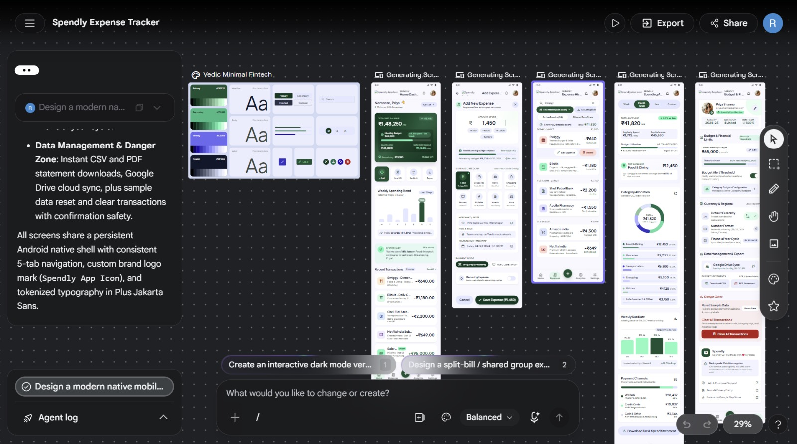
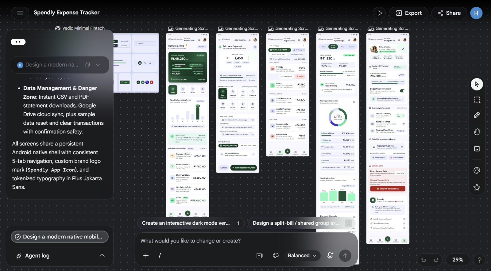
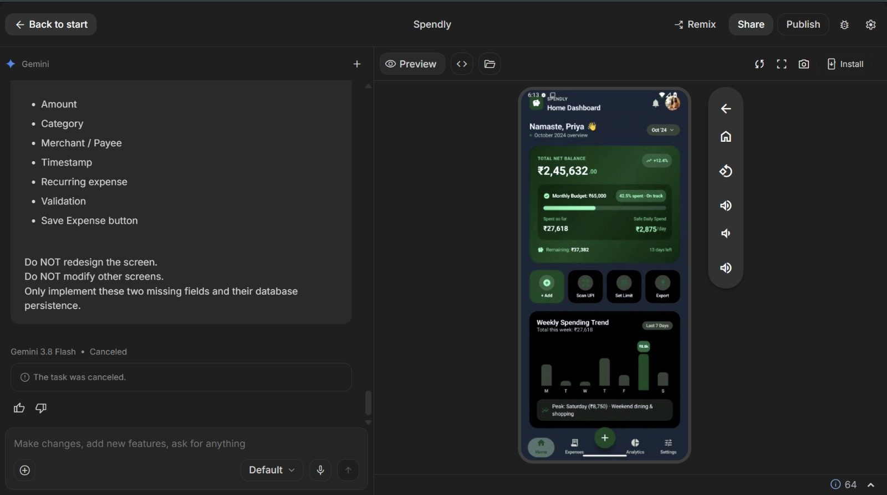
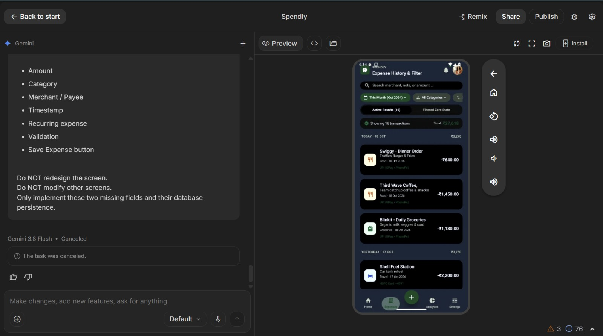
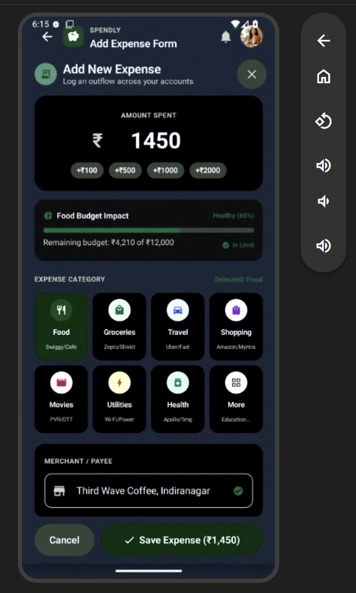

# 💰 Spendly — Expense Tracker

A modern native Android expense tracker built with **Kotlin, Jetpack Compose, and Room Database**, designed for managing daily expenses, budgets, and spending analytics.

Spendly was developed as an exploration of an **AI-assisted software development workflow**, using **Google Stitch** for AI-assisted UI/UX design and **Google AI Studio** for application development, followed by functional testing, validation, and iteration.

---

## 📱 Project Overview

Spendly helps users track personal expenses in **Indian Rupees (₹)**, manage monthly budgets, and understand their spending patterns.

The application uses a **local-first approach**, with expense data persisted locally using Room Database.

### ✨ Key Features

- 💰 Expense tracking in Indian Rupees (₹)
- 📊 Monthly budget management
- ➕ Create expenses
- ✏️ Edit expenses
- 🗑️ Delete expenses
- 🔎 Search and filter transactions
- 📈 Spending analytics and trends
- 🏷️ Expense categories
- 💳 Multiple payment methods
- 💾 Local data persistence
- 📅 Date-based transaction organization
- ✅ Input validation
- 📱 Native Android interface

---

## 🖼️ Screenshots

### 🎨 AI-Assisted UI/UX Design — Google Stitch

The initial Spendly interface was explored and generated using **Google Stitch**, an experimental AI-powered design tool from Google.

The goal was to move from natural-language product requirements to a structured mobile UI design before application development.

<p align="center">
  
</p>

---

### ⚙️ Application Development — Google AI Studio

After establishing the UI/UX direction, the application was developed using **Google AI Studio**.

<p align="center">
  
</p>

---

### ➕ Add Expense

The Add Expense screen allows users to record their spending by entering an amount, selecting a category, and specifying the merchant/payee.

<p align="center">
  
</p>

---

### 📋 Expense History

Users can view their transactions and search or filter their expense history.

<p align="center">
  
</p>

---

### 📊 Spending Analytics

The analytics screen provides an overview of spending, budget utilization, category allocation, and financial trends.

<p align="center">
  
</p>

---

## 🤖 AI-Assisted Development Workflow

One of the main objectives of this project was to explore how AI can change the traditional software development workflow.

### Traditional Workflow

```text
Product Requirements
        ↓
Wireframes
        ↓
UI/UX Design
        ↓
Prototype
        ↓
Application Development
        ↓
Testing
```

### Workflow Used for Spendly

```text
Product Idea
      ↓
Natural-Language Requirements
      ↓
Google Stitch
      ↓
AI-Assisted UI/UX Design
      ↓
Design Refinement
      ↓
Google AI Studio
      ↓
Native Android Application
      ↓
Code Inspection
      ↓
Functional Testing
      ↓
Validation & Iteration
      ↓
GitHub
```

### 🎨 Google Stitch

**Google Stitch** was used during the UI/UX exploration stage.

The product requirements were described in natural language and Stitch was used to generate and iterate on the initial mobile interface.

Stitch is an **experimental/beta-stage Google Labs technology**, making this project an opportunity to explore an emerging AI-first approach to interface design.

### ⚙️ Google AI Studio

**Google AI Studio** was then used to turn the design direction into a functional native Android application.

The generated application was not treated as a static prototype.

The project involved inspecting the generated application structure, testing its functionality, identifying issues, and validating the final behavior.

---

## 🧠 What This Project Taught Me

The most valuable part of this project was not simply generating an application with AI.

It was learning a new development loop:

```text
Describe
   ↓
Generate
   ↓
Inspect
   ↓
Test
   ↓
Validate
   ↓
Iterate
```

AI can reduce repetitive implementation work and accelerate early design and development.

However, software engineering fundamentals remain important.

Understanding:

- Requirements
- Application architecture
- Data flow
- State management
- Database persistence
- Debugging
- Testing
- Validation
- Generated code

is still essential when turning an AI-generated concept into a reliable application.

---

## 🏗️ Architecture

Spendly follows an **MVVM-style architecture** with a local Room database.

```text
┌───────────────────────────────┐
│       Jetpack Compose UI      │
│                               │
│ Home │ Expenses │ Add │       │
│ Analytics │ Settings          │
└───────────────┬───────────────┘
                │
                ▼
┌───────────────────────────────┐
│           ViewModel           │
│       StateFlow / State       │
└───────────────┬───────────────┘
                │
                ▼
┌───────────────────────────────┐
│          Repository            │
│       ExpenseRepository        │
└───────────────┬───────────────┘
                │
                ▼
┌───────────────────────────────┐
│         Room Database          │
│                               │
│ ExpenseEntity                 │
│ AppSettingsEntity             │
│ ExpenseDao                    │
│ AppSettingsDao                │
└───────────────────────────────┘
```

---

## 🛠️ Technology Stack

| Technology | Purpose |
|---|---|
| **Kotlin** | Android application development |
| **Jetpack Compose** | Modern native Android UI |
| **Material 3** | UI components and design system |
| **Room Database** | Local data persistence |
| **ViewModel** | UI state management |
| **StateFlow** | Reactive state updates |
| **MVVM** | Application architecture |
| **Gradle** | Build system |
| **Google Stitch** | AI-assisted UI/UX design |
| **Google AI Studio** | AI-assisted application development |
| **GitHub** | Source control and project hosting |

---

## 🧪 Functional Testing

The application was tested through real user workflows rather than being treated as a static generated prototype.

| Test | Result |
|---|---|
| Screen navigation | ✅ PASS |
| Create expense | ✅ PASS |
| Expense history | ✅ PASS |
| Edit expense | ✅ PASS |
| Delete expense | ✅ PASS |
| Dashboard calculations | ✅ PASS |
| Analytics updates | ✅ PASS |
| Persistence after restart | ✅ PASS |
| Search and filtering | ✅ PASS |
| Input validation | ✅ PASS |

---

## 📂 Project Structure

```text
Spendly-Expense-Tracker/
│
├── app/
│   └── src/
│
├── docs/
│   └── screenshots/
│       ├── stitch-ui-generation.png
│       ├── ai-studio-dashboard.png
│       ├── add-expense.png
│       ├── expense-history.png
│       └── spending-analytics.png
│
├── gradle/
├── .env.example
├── .gitignore
├── build.gradle.kts
├── gradle.properties
├── metadata.json
├── settings.gradle.kts
└── README.md
```

---

## 🚀 Running the Project

### Prerequisites

- Android Studio
- Android SDK
- JDK compatible with the project
- Git

### Setup

1. Clone the repository.
2. Open the project in Android Studio.
3. Allow Gradle to synchronize.
4. Start an Android emulator or connect an Android device.
5. Build and run the application.

---

## 🔐 Data & Privacy

Spendly follows a local-first design.

Expense records are persisted locally using **Room Database**, allowing the core expense-tracking functionality to work without requiring a remote backend.

---

## 🔮 Future Improvements

Possible future improvements include:

- 📤 Enhanced CSV export
- 📄 PDF financial reports
- ☁️ Optional cloud synchronization
- 🔐 Biometric application lock
- 🔔 Budget notifications
- 📅 Advanced financial reports
- 📈 More detailed analytics
- 💱 Multi-currency support
- 🧪 Expanded automated testing
- ⚙️ CI/CD pipeline

---

## 👨‍💻 Author

### Rahul K V

Computer Science / AI & ML

Built as a practical exploration of **AI-assisted software development, native Android development, and modern application architecture**.

---

## ⭐ Project

If you find the project interesting, consider giving the repository a ⭐.

**Spendly — From idea → AI-assisted design → functional Android application → testing → GitHub.**
